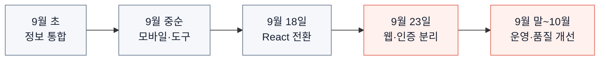

# 01. 발전 과정 — 순위표에서 운영 서비스로

[프로젝트 소개](../../README.md) · [02. 서비스 기획](02-product.md) · [03. 풀스택 구조](03-architecture.md)

**moncamp는 포켓몬 GO 순위표에서 출발해, 탐색·배틀 준비·계정 기능을 연결한 웹 서비스로 발전했습니다.** 기능이 늘어날 때마다 화면, 데이터, 인증, 운영의 책임을 단계적으로 나눴습니다.

기간은 2026년 9월 1일부터이며, 기획·UI·웹·인증 API·데이터 처리·운영을 담당했습니다. 아래는 2026년 10월 15일까지의 구현 기록입니다.

## 어떤 필요가 다음 단계로 이어졌나요?

## 단계별로 달라진 판단

| 단계 | 해결해야 했던 문제 | 선택과 결과 |
| --- | --- | --- |
| 정보 통합 | 일정과 배틀 성능을 각각 찾아야 했음 | 도감·일정·순위를 같은 서비스에서 탐색하도록 구성 |
| 사용성 개선 | 모바일의 긴 목록과 무거운 첫 화면 | 검색·계산 도구를 연결하고 자산 분리·지연 로딩 적용 |
| React 전환 | 화면과 상태가 늘면서 수정 영향이 커짐 | 컴포넌트와 표시 함수를 나누고 이전 화면·데이터와 비교 |
| 풀스택 확장 | 해시 주소의 한계와 분산된 계정 처리 | 경로별 HTML, Fastify 인증 API, Neon 데이터 이관 |
| 운영 개선 | 수집 실패·권한·배포 상태를 따로 확인해야 했음 | 데이터 검증, 회귀 검사, 환경별 배포 확인을 연결 |

## 근거가 있는 개선 사례

- **공통 UI 정리:** 2026년 9월 24~27일 기록에서 디자인 CSS는 100KB에서 67KB, 이미지 자산 묶음은 PNG 21MB에서 WebP 1.4MB로 줄었습니다. 해당 파일 묶음의 크기이며 전체 서비스 전송량은 아닙니다. [PR #180](https://github.com/MinsangKwak/pogo-rank/pull/180) · [#181](https://github.com/MinsangKwak/pogo-rank/pull/181)
- **홈 개선 검증:** PR #369에서 웹 테스트 224건과 빌드 통과를 확인하고 dev에 반영했습니다. 운영 출시 여부는 별도로 관리했습니다. [PR #369](https://github.com/MinsangKwak/pogo-rank/pull/369)
- **호스팅 전환:** 10월 15일 Cloudflare Pages 전환 후 운영 도메인, 상세 경로, www 리다이렉트와 ads.txt를 확인했습니다. [검증 기록](https://github.com/MinsangKwak/pogo-rank/actions/runs/38667802446)

## 현재 상태와 다음 과제

10월 15일 확인 기준으로 dev·main·deploy의 앱 버전은 **v5.10.2**입니다. 새 홈과 보스·일정 개선의 운영 반영을 마쳤고, [Pages 배포 성공](https://github.com/MinsangKwak/pogo-rank/actions/runs/38682428361)을 확인했습니다. 광고 코드는 준비됐지만 시행일이 설정되지 않아 실제 송출은 꺼져 있습니다.

다음 과제는 현재 DB의 복원 검증, 복합 타입·폼 처리의 일관성, 접근성 점검입니다. 완료된 구현과 후속 확인을 구분해 [로드맵](../ROADMAP.md)에 기록합니다.

세부 날짜별 변화는 [개발 이력](../HISTORY.md), 당시 수정·검증 기록은 [변경 이력](../CHANGELOG.md)에서 확인할 수 있습니다.
