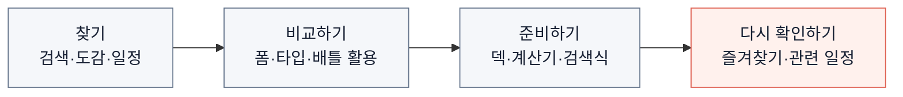

# 02. 서비스 기획 — 정보를 다음 행동으로 연결하기

[프로젝트 소개](../../README.md) · [01. 발전 과정](01-journey.md) · [03. 풀스택 구조](03-architecture.md)

**moncamp는 “지금 무엇을 잡고, 어떤 포켓몬을 키워야 할까?”를 판단하도록 돕는 서비스입니다.** 도감·일정·배틀 성능을 연결해 사용자가 정보를 확인한 뒤 바로 준비 단계로 이동할 수 있도록 설계했습니다.

주요 사용자는 모바일로 일정과 추천을 확인하는 포켓몬 GO 이용자입니다. 담당 범위는 사용자 흐름, 정보 위계, 반응형 UI, 공통 디자인과 피드백 반영입니다.

## 사용자의 목적을 기준으로 구성했습니다

## 기능보다 먼저 정한 정보의 역할

| 사용자 상황 | 필요한 정보 | 설계한 흐름 |
| --- | --- | --- |
| 참여할 콘텐츠를 찾을 때 | 진행 기간과 등장 대상 | 이번 주 보스·일정에서 포켓몬과 준비 도구로 연결 |
| 포켓몬을 빠르게 확인할 때 | 이름·폼·진화·핵심 활용 | 요약 팝업에서 대상을 이해하고 상세 비교로 이동 |
| 육성 대상을 결정할 때 | 기술·상성·성능과 계산 조건 | 도감 상세와 배틀별 순위에서 용도에 맞게 비교 |
| 게임에 적용할 때 | 팀 구성과 실제 검색 조건 | 덱·계산기·검색식으로 준비를 이어감 |

검색 결과에 모든 수치를 넣지 않았습니다. 빠른 확인과 자세한 비교의 깊이를 나누고, 화면을 이동해도 선택한 종·폼·배틀 맥락이 이어지도록 했습니다. 현재 진입 규칙은 [팝업 기준](../../.claude/CLAUDE.md#3-1-팝업은-요약-자세한-것은-상세-화면)에 정리했습니다.

## 피드백을 공통 UI 규칙으로 바꿨습니다

큰 빈 이미지 영역, 과한 배지, 반복 정보, 일정하지 않은 카드 간격을 피드백으로 확인했습니다. 화면마다 개별 보정하기보다 다음 기준을 공통으로 적용했습니다.

1. **읽는 순서:** 이름·폼 → 핵심 지표 → 설명 → 다음 행동.
2. **정보량:** 요약에서는 핵심 활용을, 상세에서는 판단 근거를 제공.
3. **반응형:** 카드 1개·여러 폼·긴 이름·빈 데이터에서도 위계 유지.
4. **조작:** 닫기 버튼, 터치 영역, 키보드 포커스를 함께 확인.

상세 팝업은 당시 390px·1280px에서 이상해꽃·리자몽·거북왕·따라큐를 확인했습니다. 폼 수와 이름 길이가 다른 사례로 배치와 정보 연결을 점검했습니다. [PR #266](https://github.com/MinsangKwak/pogo-rank/pull/266) · [#269](https://github.com/MinsangKwak/pogo-rank/pull/269) · [#271](https://github.com/MinsangKwak/pogo-rank/pull/271)

## 결과를 해석하는 기준

구현 결과는 정보 구조와 탐색 흐름의 개선입니다. 전환율과 이용자 증가 효과는 아직 측정하지 않았습니다. 이후 개선은 사용 기록과 제보를 바탕으로 판단합니다.

디자인 구현은 [공통 스타일과 검증](../design/README.md), 기능의 제약과 남은 작업은 [로드맵](../ROADMAP.md)에서 이어서 볼 수 있습니다.
