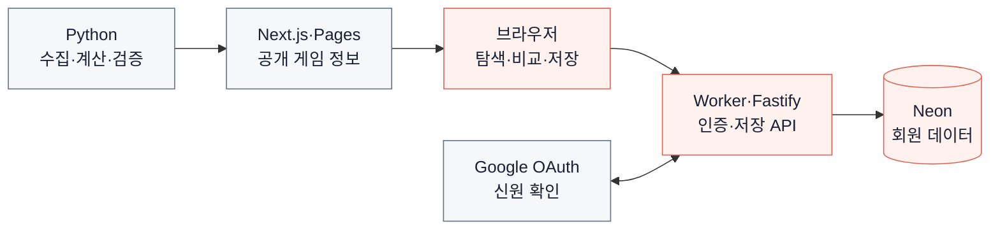

# 03. 풀스택 구조 — 공개 정보와 사용자 데이터를 분리하기

[프로젝트 소개](../../README.md) · [01. 발전 과정](01-journey.md) · [02. 서비스 기획](02-product.md)

**게임 정보는 빌드 시 가공해 정적으로 제공하고, 로그인과 저장 기능은 API로 처리합니다.** 데이터 갱신과 사용자 요청의 성격이 달라 웹·인증 서버·데이터 파이프라인의 책임을 나눴습니다.

2026년 10월 15일 운영 구성 기준입니다. 담당 범위는 웹과 상태 관리, 인증·권한, 데이터 이관·검증, 배포와 운영 확인입니다.

## 서비스 구성도

원본은 PvPoke·PokeMiners·PokeAPI와 일정 자료입니다. 게임 정보는 빌드 시 가공하고, 계정 요청은 사용 시점에 처리합니다.

## 각 계층에서 해결한 문제

| 영역 | 기술 선택과 이유 | 구현 근거 |
| --- | --- | --- |
| 웹 | Next.js로 포켓몬별 HTML·메타데이터를 생성하고 React로 탐색 제공 | [상세 라우트](../../web/app/%5B...slug%5D/page.tsx) |
| API 경로 | Worker가 요청을 중계하고 Cloud Run의 Fastify가 인증·저장 처리 | [인프라 구성](../INFRA.md#구성과-책임) |
| 상태 | URL은 공유할 선택, Query는 조회·캐시, Zustand는 공유 UI 상태 담당 | [웹 구조](../DEVELOPMENT.md#web-structure) |
| 인증 | OAuth PKCE로 신원을 확인하고 서버가 역할·실험 권한을 별도 검사 | [인증·권한 설계](../../server/AUTH.md) |
| 저장 | PostgreSQL 제약·트랜잭션으로 즐겨찾기 중복과 동시 추가 처리 | [스키마](../../server/SCHEMA.md) |
| 데이터 | 원본을 내부 식별자로 맞추고 필수 데이터 누락 시 빌드 중단 | [검증 코드](../../backend/guard.py) |

## 인증과 데이터의 경계

액세스 JWT는 브라우저 메모리에, 리프레시 토큰은 HttpOnly 쿠키에 보관합니다. 서버는 리프레시 토큰의 해시를 저장하고 회전·재사용을 검사합니다. 회원 승인, 관리자 역할, 실험 기능 권한을 같은 조건으로 취급하지 않습니다.

게임 데이터는 정적 파일로 조회합니다. 계정·즐겨찾기·통계는 API를 거칩니다. API 장애 시 로그인·저장은 영향을 받지만, 정적 게임 콘텐츠의 제공 경로와는 분리됩니다.

## 배포와 검증

GitHub Actions에서 데이터와 앱을 빌드합니다. dev 미리보기는 Vercel, 운영 웹은 Cloudflare Pages, API는 Cloud Run에 배포합니다. 기능별 테스트와 별도로 실제 도메인·상세 HTML·리다이렉트·로그인 흐름을 확인합니다.

운영 반영은 승인된 변경 범위로 제한합니다. 문서 변경만 반영할 때는 기능 커밋이 섞이지 않는지 diff를 확인합니다. [운영 가이드](../OPERATIONS.md) · [인프라와 전환 검증](../INFRA.md#pages)

## 선택의 한계와 후속 확인

정적 정보와 계정 요청을 분리한 대신 여러 서비스의 설정을 함께 관리해야 합니다. Cloud Run 시작 시간과 DB 연결은 API 지연에 영향을 줄 수 있습니다. 현재 DB 복원 검증과 이전 Firebase·v4 도구의 의존성 정리는 후속 과제로 남아 있습니다.
